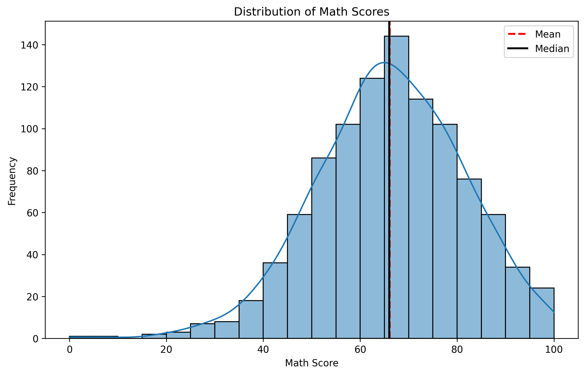
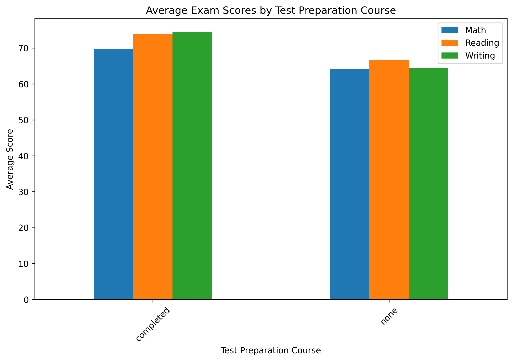
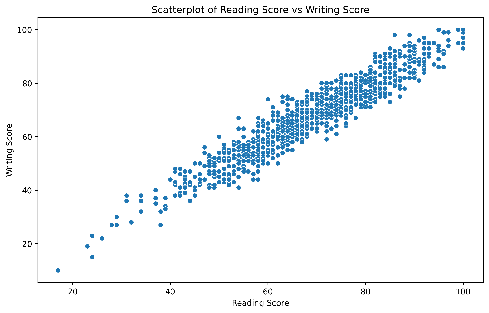

# Student-Performance-Exploratory Data Analysis
## 1.Project Overview

This project explores the academic performance of 1,000 students using exploratory data analysis (EDA) and data visualization. The analysis focuses on mathematics, reading, and writing scores, investigating how student characteristics and educational factors are associated with academic outcomes.

The project was completed as part of the AXSOS Academy Data Science and Machine Learning Bootcamp — Exploratory Data Visualization Solo Project.

## 2.Business Problem and Objective

Schools need to understand student performance patterns to identify learning difficulties and provide effective academic support.

The main objectives of this project are to:
- Understand the distribution of mathematics scores.
- Examine the relationship between test preparation and exam performance.
- Investigate the relationship between reading and writing scores.
- Explore performance differences across gender, parental education, and lunch categories.
- Provide practical recommendations to support student achievement.

## 3.Dataset Summary

The dataset contains 1,000 student records, with information about academic performance and student characteristics.
| Feature | Description |
|---------|-------------|
| gender | Student gender (female or male) |
| race_ethnicity | Anonymized student groups (A–E) |
| parental_level_of_education | Highest reported parental education level |
| lunch | Standard or free/reduced lunch |
| test_Preparation_course | Whether the student completed a preparation course |
| math_score | Mathematics exam score (0–100) |
| reading_score | Reading exam score (0–100) |
| writing_score | Writing exam score (0–100) |

During data preprocessing, four additional features were created:

| Feature | Description |
|---------|-------------|
| `total_score` | Sum of mathematics, reading, and writing scores |
| `average_score` | Average of mathematics, reading, and writing scores |
| `pass_math` | Indicates whether a student passed mathematics based on the defined passing threshold |
| `performance_level` | Categorizes students into performance levels based on their average scores |

## 4.Methodology

The analysis was conducted using Python, Pandas, NumPy, Matplotlib, Seaborn, and SciPy in Google Colab.
The main steps included:

1.Loading and inspecting the dataset for missing values, duplicates, and data quality issues.

2.Preparing the data and creating additional performance indicators.

3.Calculating descriptive statistics and examining score distributions.

4.Creating univariate and multivariate visualizations.

5.Exploring correlations and differences between student groups.

6.Applying a normality test and a t-test to support statistical interpretation.

7.Summarizing the findings and developing practical recommendations.

## 5.Key Findings and Visualizations

### 5.1 Mathematics Score Distribution

Mathematics scores are approximately bell-shaped, with a **mean of 66.09 and a median of 66** The distribution shows a slight negative skew, indicating a somewhat longer tail toward lower scores.

Although the distribution visually resembles a normal distribution, the normality test produced a p-value of approximately 0.00045, indicating a statistically significant departure from normality.

Mathematics scores are approximately bell-shaped, with a mean
of 66.09 and a median of 66.

### 5.2 Test Preparation and Academic Performance

Students who completed the test preparation course achieved higher average scores in mathematics, reading, and writing compared with those who did not complete it.

The largest difference was observed in writing scores. Additionally, a t-test comparing overall average scores found a statistically significant difference (p < 0.05) between the two groups.

These findings suggest that test preparation is positively associated with academic performance, although they do not establish causation.

Students who completed the test preparation course achieved higher average scores in mathematics, reading, and writing.

### 5.3 Relationship Between Reading and Writing Scores

Reading and writing scores demonstrate a very strong positive correlation (r ≈ 0.95).

Students who achieve higher reading scores generally tend to achieve higher writing scores, suggesting a close relationship between the two academic skills.

Reading and writing scores demonstrate a very strong positive correlation (r ≈ 0.95).

### 5.4 Additional Findings
- **Parental education** : Students whose parents have higher educational qualifications generally achieve higher median average scores, although the distributions overlap.
- **Gender** :  Female students generally achieve slightly higher overall average scores than male students, with considerable overlap between groups.
- **Lunch category** : Students receiving standard lunch generally achieve higher average scores than those receiving free/reduced lunch. This may reflect differences in socioeconomic circumstances, but the analysis cannot establish the underlying cause.

## 6. Recommendations

Based on the findings, schools could consider the following actions:
- Encourage participation in test preparation programs, while evaluating their effectiveness through further research.
- Provide additional academic support to students with lower scores across all three subjects, particularly mathematics, which has the lowest average score.
- Strengthen reading and writing skills together through integrated learning activities.
- Provide additional educational resources and academic support to students from lower-income families to help reduce performance gaps.
- Monitor academic performance regularly to identify students who may need early intervention.

## 7. Limitations

Although this analysis provides valuable insights into student academic performance, several limitations have been observed: 

- The dataset contains 1,000 students and may not represent all schools or student populations.
- The analysis identifies associations but cannot establish cause-and-effect relationships.
- Important factors such as attendance, study hours, teaching quality, and family income are not directly available.
- Some categorical variables have unequal group sizes, which may reduce the precision of comparisons involving smaller groups.
- Race/ethnicity categories are anonymized, limiting their interpretation.
- Outliers may influence certain statistical summaries.

## 8. Suggested Next Steps

Future work could include:

- Collecting additional information about attendance, study habits, and socioeconomic(family financials) circumstances.
- Conducting further statistical tests to assess differences between student groups.
- Developing predictive machine learning models for student performance.
- Investigating the factors most strongly associated with academic achievement.
- Creating an interactive dashboard for monitoring student performance.

